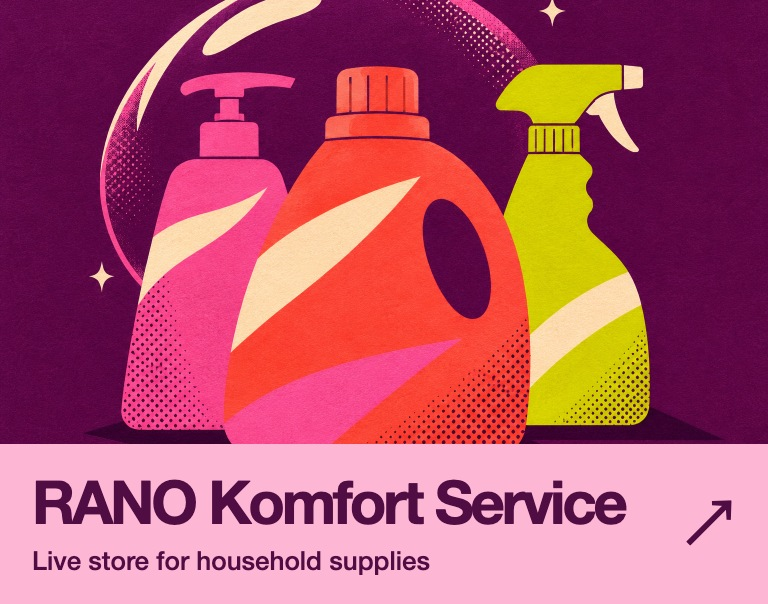

<p></p>

<p>
  <picture>
    <source media="(prefers-reduced-motion: no-preference)" srcset="./assets/paper-flight.svg" />
    
  </picture>
</p>

<p align="center">
  
  
  
  
  
  
</p>

## Сәлем, I’m Janibek.

I study computer science in Kazakhstan and build full-stack applications. I’m especially interested in the work between a form and a database. In one project that means deciding what an applicant can trust about a university. In another it means keeping track of exactly what someone ordered.

<p align="center">
  <a href="https://github.com/KazakbayZhanibek/edumatch.kz"><picture><source media="(max-width: 640px)" srcset="./assets/edumatch-small.jpg" /></picture></a>
  <a href="https://rano-comfort.vercel.app/catalog"><picture><source media="(max-width: 640px)" srcset="./assets/rano-small.jpg" /></picture></a>
</p>

### EduMatch KZ · From exam scores to a shortlist

A student can enter their Unified National Test (UNT) score and subject choices, compare up to three universities, explore grants, and save an application checklist. EduMatch is a working prototype built with Node.js, Express, and SQLite.

One detail matters when showing a match. A programme can fit the student’s scores while its deadline is still unverified. The API checks the subjects, score, city, and deadline before assigning a status.

```js
const hasUnknownCritical = critical.some(
  key => candidate.checks?.[key] === 'unverified'
);

status = hasUnknownCritical
  ? 'needsClarification'
  : 'matched';
```

The API returns the reasons and warnings alongside that status, so an applicant knows what to double-check before applying. [Read the matching logic ↗](https://github.com/KazakbayZhanibek/edumatch.kz/blob/10d4d11453ba9c7c35153d1a0df25a523acd4abf/backend/grants-routes.js#L242-L259)

### RANO Komfort Service · From cart to order

RANO is a Next.js store for household supplies. Shoppers can browse by category, compare pack sizes and prices, and choose delivery or pickup. The checkout asks for a street address when the customer selects home delivery. [Try the catalog ↗](https://rano-comfort.vercel.app/catalog)

Each order records the product, pack size, unit price, and quantity. Once the order is saved, the API uses Prisma to update the stock count. If five units or fewer remain, it triggers a low-stock alert. [Follow an order through the API ↗](https://github.com/KazakbayZhanibek/rano-comfort/blob/d4a81af8ae487a2ac3229de344191c76a8c5b5d8/app/api/orders/route.ts#L45-L99)

### Other things I’ve built

- **Belle Croissant Lyonnais** — a bakery management app. I paired Django with PyWebView so staff can use the web interface in a desktop window.
- **Forum Platform** — a SQL-backed discussion forum with user roles, an XP system, and migrations for changing the database schema.

### What I’m learning

I’m going deeper into SQL, Docker, and backend architecture. One question I want to explore next is how to keep an order and its stock update consistent if a database write fails.

[Telegram · @tibio_404](https://t.me/tibio_404) &nbsp; · &nbsp; [Email](mailto:janibekkaz3@gmail.com) &nbsp; · &nbsp; [LinkedIn](https://kz.linkedin.com/in/zhanibek-kazakbay-7a1909359)
