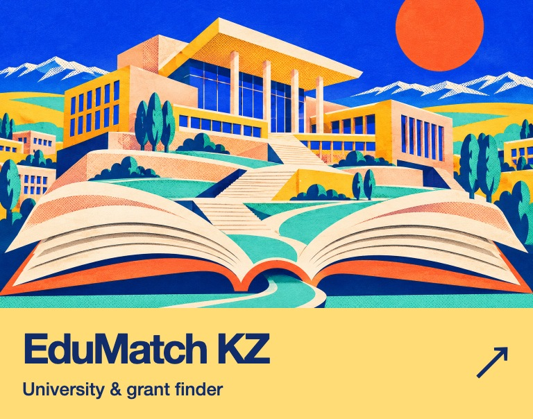

<p></p>

<p align="center">
  
  
  
  
  
  
</p>

<p align="center">
  <a href="https://github.com/KazakbayZhanibek/edumatch.kz"><picture><source media="(max-width: 640px)" srcset="./assets/edumatch-small.jpg" /></picture></a>
  <a href="https://rano-comfort.vercel.app/catalog"><picture><source media="(max-width: 640px)" srcset="./assets/rano-small.jpg" /></picture></a>
</p>

In **EduMatch KZ**, I help students in Kazakhstan check university admissions requirements. A programme might fit a student’s exam scores while its deadline still needs checking. This line in my Express API keeps that uncertainty visible.

```js
status = hasUnknownCritical
  ? 'needsClarification'
  : 'matched';
```

[Read the matching logic ↗](https://github.com/KazakbayZhanibek/edumatch.kz/blob/10d4d11453ba9c7c35153d1a0df25a523acd4abf/backend/grants-routes.js#L247-L251)

**Also in my code** &nbsp; The [RANO checkout](https://github.com/KazakbayZhanibek/rano-comfort/blob/d4a81af8ae487a2ac3229de344191c76a8c5b5d8/app/checkout/page.tsx#L89-L92) handles delivery and pickup in Next.js. For Belle Croissant Lyonnais, I paired Django with PyWebView to bring bakery operations to the desktop.

[Telegram · @tibio_404](https://t.me/tibio_404) &nbsp; · &nbsp; [Email](mailto:janibekkaz3@gmail.com) &nbsp; · &nbsp; [LinkedIn](https://kz.linkedin.com/in/zhanibek-kazakbay-7a1909359)
