

  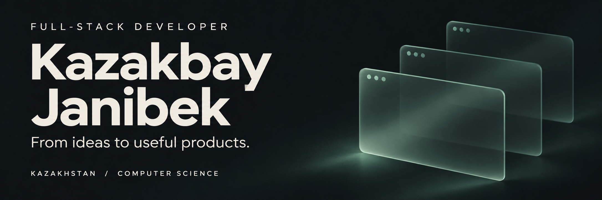

  
  <a href="mailto:janibekkaz3@gmail.com">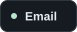</a>
  <a href="https://kz.linkedin.com/in/zhanibek-kazakbay-7a1909359">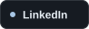</a>

 

## A little about me

I'm a **Computer Science student from Kazakhstan** building full-stack applications,
dashboards, and educational products. I enjoy connecting thoughtful interfaces
with practical backend systems.

I'm especially interested in **AI integrations**, **startup MVPs**, and the
architecture behind reliable web applications.

## Selected work

<table>
  <tr>
    <td width="35%" valign="top">
      <h3><a href="https://github.com/KazakbayZhanibek/edumatch.kz">EduMatch KZ ↗</a></h3>
      
01 / EDUCATION · AI

    </td>
    <td width="65%" valign="top">
      
An AI-powered platform that helps students choose universities in Kazakhstan.

      
<code>Node.js</code> <code>Express</code> <code>SQLite</code> <code>HTML / CSS / JavaScript</code> <code>AI integration</code>

    </td>
  </tr>
  <tr>
    <td valign="top">
      <h3>Belle Croissant Lyonnais</h3>
      
02 / BUSINESS SOFTWARE

    </td>
    <td valign="top">
      
A desktop and web management system for bakery operations.

      
<code>Python</code> <code>Django</code> <code>PyWebView</code>

    </td>
  </tr>
  <tr>
    <td valign="top">
      <h3>Forum Platform</h3>
      
03 / COMMUNITY

    </td>
    <td valign="top">
      
A forum application with user roles, an XP system, database migrations, and SQL-based application logic.

      
<code>HTML</code> <code>CSS</code> <code>JavaScript</code> <code>SQL</code>

    </td>
  </tr>
</table>

[Browse all repositories →](https://github.com/KazakbayZhanibek?tab=repositories)

## My toolbox

<b>FRONTEND</b>

  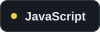
  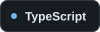
  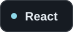
  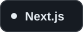
  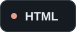
  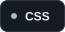

<b>BACKEND</b>

  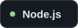
  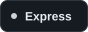
  
  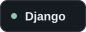
  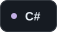
  

<b>DATABASES &amp; TOOLS</b>

  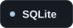
  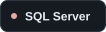
  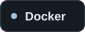
  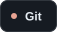
  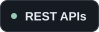

## What I'm working toward

- **Better foundations** — deepening my React, Node.js, and SQL skills.
- **Stronger systems** — improving backend architecture, system design, and Docker workflows.
- **Useful products** — turning startup ideas into MVPs and production-ready applications.

 

  
<b>A look at my GitHub activity</b>

   
  

    
  

---

  <b>Have an idea worth building?</b> 
  <a href="https://t.me/tibio_404">Let's talk on Telegram ↗</a>

