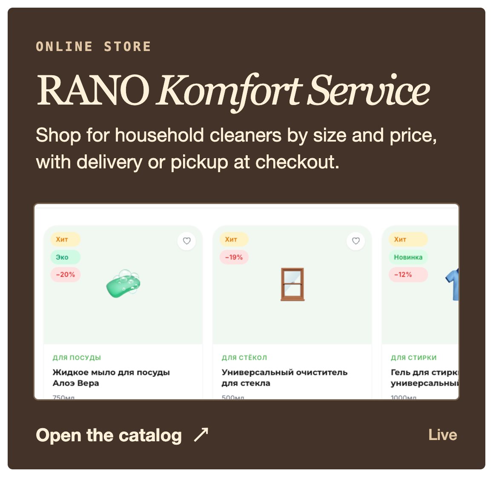

## Selected work

  
  

### Inside the code

**EduMatch KZ** · The server checks exam scores and subject choices against each grant’s requirements. It flags missing information so applicants can see what still needs checking. [Grant matching in Express ↗](https://github.com/KazakbayZhanibek/edumatch.kz/blob/main/backend/grants-routes.js#L326)

**RANO Komfort Service** · Checkout asks for an address when a shopper chooses delivery, validates the contact details, then sends the order to the API. [Checkout in Next.js ↗](https://github.com/KazakbayZhanibek/rano-comfort/blob/main/app/checkout/page.tsx#L79)

  
<b>More projects &amp; tools</b>

  
<b>Belle Croissant Lyonnais</b> uses Django and PyWebView to bring bakery operations to the web and desktop.

  
<b>Forum Platform</b> is a SQL-backed discussion forum with user roles and an XP system.

  
I also work with React, TypeScript, Python, C#, .NET, SQL Server, Git and Docker. I’m currently studying backend architecture and system design.

  
<a href="https://github.com/KazakbayZhanibek?tab=repositories">All repositories ↗</a>

---

[Telegram · @tibio_404](https://t.me/tibio_404) &nbsp; · &nbsp; [Email](mailto:janibekkaz3@gmail.com) &nbsp; · &nbsp; [LinkedIn](https://kz.linkedin.com/in/zhanibek-kazakbay-7a1909359)
